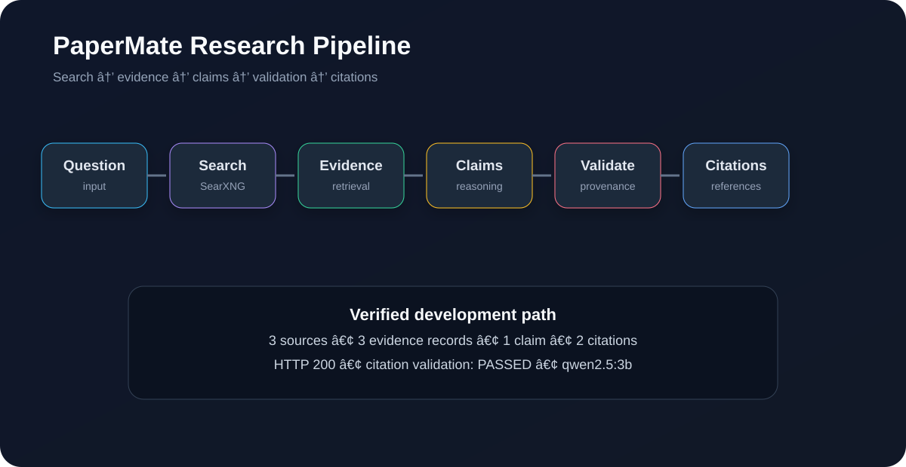
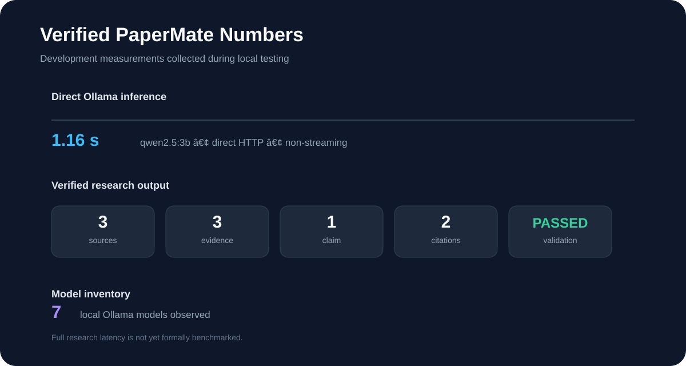

# âš¡ PaperMate

> **Local-first research intelligence infrastructure for evidence-grounded AI.**

[](STATUS.md)
[](https://www.python.org/)
[](https://ollama.com/)
[](https://docs.searxng.org/)

PaperMate is an experimental **research backend** built around a simple idea:

> **Research should be traceable, not merely generated.**

Instead of treating web search as a prompt for an unconstrained answer, PaperMate separates research into explicit stages and preserves the relationships between **sources, evidence, claims, citations, and provenance**.

---

## 📌 At a Glance

| Metric | Verified value |
|---|---:|
| Research API | `POST /research` |
| Successful research test | **HTTP 200** |
| Sources in verified run | **3** |
| Evidence records | **3** |
| Claims | **1** |
| Citations | **2** |
| References | **2** |
| Citation validation | **PASSED** |
| Local Ollama models observed | **7** |
| Direct `qwen2.5:3b` baseline | **1.16 s** |
| Search backend | SearXNG |
| Inference backend | Ollama |

> The numbers above are development measurements, not production benchmarks.

---

## 🧬 Research Pipeline



The core flow is:

```text
Question
   ↓
Search
   ↓
Retrieval
   ↓
Evidence
   ↓
Claims
   ↓
Validation
   ↓
Citations
   ↓
Structured answer
```

### Evidence chain

```text
SOURCE
  ↓
EVIDENCE
  ↓
CLAIM
  ↓
CITATION
  ↓
ANSWER
```

This structure is the central architectural idea behind PaperMate. The answer is not the only artifact produced by research; the intermediate provenance is part of the output.

---

## 🔍 What PaperMate Currently Provides

### Research

PaperMate can perform a research request against retrieved web material and return a structured research object.

### Evidence

Evidence is kept as a first-class object with an association to the source that produced it.

### Claims

Claims are represented separately from the final answer and retain the evidence IDs used to support them.

### Citation validation

The research pipeline validates the relationship between generated claims and retrieved evidence before returning a successful research result.

### Provenance

Research responses retain execution metadata describing the pipeline and model run used to produce the result.

### Local inference

Ollama is used as the local inference layer, keeping the core research path compatible with a local-first deployment.

### Memory

The repository also contains an experimental memory layer centered around MemPalace. This part of the system is still under development.

---

## ⚙️ Current Stack

| Layer | Current implementation |
|---|---|
| Research API | Python backend |
| Search | SearXNG |
| LLM inference | Ollama |
| Tested LLM | `qwen2.5:3b` |
| Embedding candidate | `bge-m3:latest` |
| Memory | MemPalace prototype |
| Storage | Local project/storage layers |
| Tests | Python test suite |

### Local endpoints

```text
Ollama   → http://127.0.0.1:11434
SearXNG  → local Docker service / port 8080
Research → POST /research
```

---

## 🧪 Verified Research Run

The following request has been exercised successfully:

> **What are randomized controlled trials used for?**

The verified output contained:

- **3** sources
- **3** evidence records
- **1** claim
- **2** citations
- **2** references
- citation validation: **passed**

The reported execution pipeline was:

```text
searxng
   ↓
evidence
   ↓
ollama
   ↓
claim_validation
   ↓
citation_rendering
```

This is the current end-to-end proof that the main research path works as intended.

---

## âš¡ Local Model Baseline

A direct HTTP request to Ollama using `qwen2.5:3b` was measured at approximately:

# **1.16 seconds**

That measurement is intentionally labelled as a **raw inference baseline**.

It does **not** represent full research latency. A real research operation also includes source discovery, retrieval, evidence processing, validation, and response generation.



---

## 🧠 Model Inventory

The local Ollama installation observed during development contained **7 models**:

| # | Model | Role observed |
|---:|---|---|
| 1 | `qwen2.5:3b` | General local LLM / verified research model |
| 2 | `sage-browser-vl:latest` | Local multimodal model |
| 3 | `qwen3-vl:2b` | Local multimodal model |
| 4 | `bge-m3:latest` | Embedding candidate |
| 5 | `gemma3:1b-it-qat` | General local model |
| 6 | `qwen3:1.7b` | Lightweight local model |
| 7 | `llama3.2:latest` | General local model |

Model selection remains an implementation decision rather than a permanent commitment.

---

## 🧱 System Architecture

PaperMate is split into several logical boundaries:

```text
                        ┌──────────────────┐
                        │   Application    │
                        │  Vane / Clients  │
                        └────────┬─────────┘
                                 │
                                 â–¼
                        ┌──────────────────┐
                        │   Intelligence   │
                        │     Gateway      │
                        └────────┬─────────┘
                                 │
              ┌──────────────────┼──────────────────┐
              │                  │                  │
              â–¼                  â–¼                  â–¼
       ┌────────────┐     ┌────────────┐     ┌────────────┐
       │  Research  │     │   Memory   │     │ Providers  │
       │  Pipeline  │     │ MemPalace  │     │   Ollama   │
       └─────┬──────┘     └────────────┘     └─────┬──────┘
             │                                      │
             â–¼                                      â–¼
       ┌────────────┐                       ┌────────────┐
       │  SearXNG   │                       │ Local LLMs │
       └─────┬──────┘                       └────────────┘
             │
             â–¼
       ┌────────────┐
       │  Evidence  │
       └─────┬──────┘
             │
             â–¼
       ┌────────────┐
       │   Claims   │
       └─────┬──────┘
             │
             â–¼
       ┌────────────┐
       │ Validation │
       └─────┬──────┘
             │
             â–¼
       ┌────────────┐
       │ Citations  │
       └────────────┘
```

Each layer is intended to be replaceable without forcing the entire system to change with it.

---

## 🔌 API Contract

### `POST /research`

Example request:

```json
{
  "question": "What are randomized controlled trials used for?",
  "max_sources": 3,
  "require_citations": true
}
```

The response contains structured fields for:

```text
answer
sources[]
evidence[]
claims[]
citations[]
references[]
model_runs[]
provenance
```

See [API.md](API.md) for the detailed contract.

---

## 🛡️ Why the Evidence Layer Exists

A conventional research assistant can collapse the entire process into:

```text
Search → Prompt → Answer
```

PaperMate instead aims for:

```text
Search
  ↓
Retrieved material
  ↓
Evidence extraction
  ↓
Claim construction
  ↓
Claim/evidence validation
  ↓
Citation rendering
  ↓
Answer
```

That extra structure makes the research process inspectable and gives downstream applications more than just a string of generated text.

---

## 🧠 Memory Layer

PaperMate includes an experimental memory subsystem using MemPalace-related components.

Current work includes:

- memory contracts
- storage
- retrieval experiments
- gateway integration
- memory probing

Memory is deliberately separated from the research pipeline so that persistent context can evolve independently of search and synthesis.

---

## 🐳 Vane Evaluation

Vane integration is currently **experimental**.

A previous attempt to deeply modify Vane's native research path introduced unnecessary configuration and performance complexity, so that work was rolled back.

The current plan is intentionally open-ended:

```text
Official Vane Docker
          ↓
     Local Ollama
          ↓
      Benchmark
          ↓
 ┌────────┴────────┐
 │                 │
 â–¼                 â–¼
Vane           PaperMate
 │                 │
 └────────┬────────┘
          â–¼
   System comparison
```

Possible long-term outcomes include:

- Vane alone
- PaperMate alone
- Vane + PaperMate
- a hybrid research architecture
- independent systems

No outcome is assumed in advance.

See [docs/VANE_INTEGRATION.md](docs/VANE_INTEGRATION.md).

---

## 📈 What Will Be Measured Next

The next benchmark set will compare complete systems on the same hardware.

| Metric | Direction |
|---|---|
| Answer quality | Higher is better |
| Research depth | Higher is better |
| Evidence grounding | Higher is better |
| Citation accuracy | Higher is better |
| Time to first token | Lower is better |
| Total latency | Lower is better |
| Search latency | Lower is better |
| Model latency | Lower is better |
| CPU usage | Lower is better |
| RAM usage | Lower is better |
| GPU usage | Lower is better |
| VRAM usage | Lower is better |
| Failure rate | Lower is better |

No future performance number will be presented as a measured benchmark until it has actually been tested.

---

## 📁 Repository Layout

```text
PaperMate/
│
├── backend/          API and backend services
├── intelligence/     Intelligence contracts and providers
├── memory/           Memory contracts and MemPalace
├── research/         Research/search logic
├── infra/            Infrastructure configuration
├── tests/            Automated tests
├── docs/             Engineering documentation
│   └── assets/       README diagrams
├── data/             Local runtime data (ignored)
│
├── README.md
├── STATUS.md
├── ROADMAP.md
├── ARCHITECTURE.md
└── BENCHMARKS.md
```

---

## 🚧 Development Status

### **🟠 DEVELOPING**

PaperMate is an active engineering project rather than a finished product.

The project is currently focused on:

1. Research quality
2. Evidence and citation reliability
3. Memory evaluation
4. Local deployment
5. Reproducible benchmarking
6. Comparison against official Vane deployment

The architecture may change as experiments produce new evidence.

---

## 🗺️ Documentation

- [Project status](STATUS.md)
- [Roadmap](ROADMAP.md)
- [Architecture](ARCHITECTURE.md)
- [API](API.md)
- [Benchmarks](BENCHMARKS.md)
- [Vane integration](docs/VANE_INTEGRATION.md)
- [Sage lessons](docs/SAGE_LESSONS.md)

---

## 🎯 Engineering Principle

> **Measure first. Integrate only when the evidence justifies the complexity.**