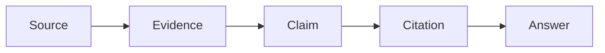
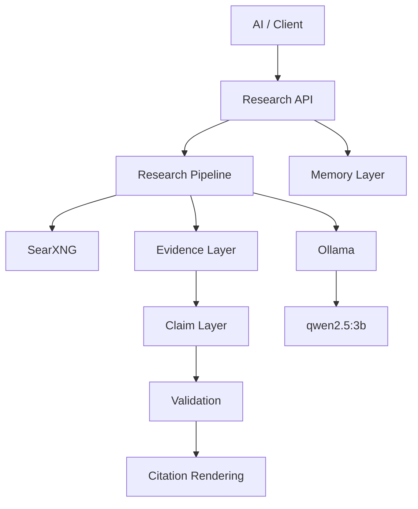
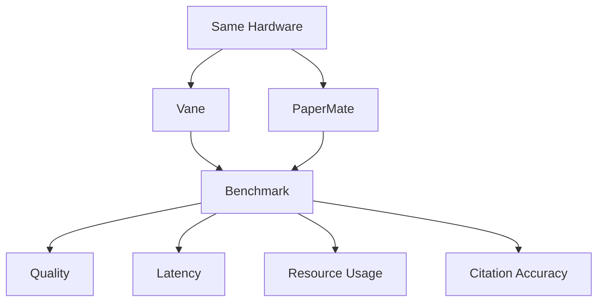

# PaperMate

> Local-first research intelligence infrastructure for evidence-grounded AI.

[](STATUS.md)
[](https://www.python.org/)
[](https://ollama.com/)
[](https://docs.searxng.org/)

PaperMate is an experimental research backend designed to turn web research
into structured, traceable, evidence-grounded output.

Instead of:

```text
Search -> Prompt -> Answer
```

PaperMate is built around:

```text
Search -> Evidence -> Claims -> Validation -> Citations -> Answer
```

**Current state: DEVELOPING**

The architecture remains intentionally open while PaperMate is evaluated against
other local research systems and deployment approaches.

---

## At a Glance

| Metric | Verified value |
|---|---:|
| Research API | `POST /research` |
| Successful research run | `HTTP 200` |
| Sources in verified run | **3** |
| Evidence records | **3** |
| Claims | **1** |
| Citations | **2** |
| References | **2** |
| Citation validation | **PASSED** |
| Local Ollama models observed | **7** |
| Direct `qwen2.5:3b` baseline | **1.16 s** |
| Search backend | SearXNG |
| Inference backend | Ollama |

> These figures are development measurements, not production benchmarks.

---

## Research Pipeline


The core research path is deliberately decomposed so the system can retain
more than a final answer.

### Evidence chain



This chain is the central design idea behind PaperMate: research output should
remain traceable to the material used to produce it.

---

## What PaperMate Currently Provides

### Research

A structured research pipeline that retrieves external information and turns
it into a machine-readable research result.

### Evidence

Evidence is represented as a first-class object and remains associated with
the source from which it was obtained.

### Claims

Claims are represented separately from the final answer and retain the
evidence IDs used to support them.

### Citation validation

The pipeline checks the relationship between generated claims and their
associated evidence before returning a successful cited research result.

### Provenance

Research responses retain execution metadata describing the pipeline and model
run used to produce the result.

### Local inference

Ollama provides local model inference for the core generation path.

### Memory

The experimental memory integration has been removed. Generic memory
contracts remain available for future implementations.

---

## Current Stack

| Layer | Current implementation |
|---|---|
| Research API | Python backend |
| Search | SearXNG |
| LLM inference | Ollama |
| Tested LLM | `qwen2.5:3b` |
| Embedding candidate | `bge-m3:latest` |
| Memory | Generic contracts; no active provider |
| Storage | Local project/storage layers |
| Tests | Python test suite |

### Local endpoints

```text
Ollama    -> http://127.0.0.1:11434
SearXNG   -> local Docker service / port 8080
Research  -> POST /research
```

---

## Verified Research Run

The following question has been successfully exercised through the PaperMate
research API:

> What are randomized controlled trials used for?

### Returned structure

| Output | Count |
|---|---:|
| Sources | **3** |
| Evidence records | **3** |
| Claims | **1** |
| Citations | **2** |
| References | **2** |

Citation validation:

**PASSED**

### Reported execution pipeline

```text
searxng
   |
   v
evidence
   |
   v
ollama
   |
   v
claim_validation
   |
   v
citation_rendering
```

This is the current end-to-end verification that the main research path can
execute and return structured evidence and citation metadata.

---

## Local Model Baseline

A direct HTTP request to local Ollama using `qwen2.5:3b` was measured at:

**1.16 seconds**

Test characteristics:

| Parameter | Value |
|---|---|
| Model | `qwen2.5:3b` |
| Endpoint | `127.0.0.1:11434` |
| Mode | Non-streaming HTTP |
| Result | Successful |
| Measured latency | **1.16 s** |

This is a raw inference measurement only.

It does not represent complete research latency, which also includes search,
retrieval, evidence processing, validation, and synthesis.

---

## Local Model Inventory

The Ollama installation observed during development contained **7 models**:

| # | Model | Role observed |
|---:|---|---|
| 1 | `qwen2.5:3b` | Verified research model |
| 2 | `sage-browser-vl:latest` | Multimodal model |
| 3 | `qwen3-vl:2b` | Multimodal model |
| 4 | `bge-m3:latest` | Embedding candidate |
| 5 | `gemma3:1b-it-qat` | General local model |
| 6 | `qwen3:1.7b` | Lightweight local model |
| 7 | `llama3.2:latest` | General local model |

Model selection remains an implementation decision.

---

## Research Data Model

PaperMate separates the main research artifacts:

```text
Source
  |
  +--> Evidence
          |
          +--> Claim
                  |
                  +--> Citation
```

### Source

```text
source_id
title
url
authors
year
source_type
```

### Evidence

```text
evidence_id
source_id
content
location
page
quote
```

### Claim

```text
claim_id
text
evidence_ids[]
```

### Citation

```text
citation_id
source_id
title
url
evidence_ids[]
```

This makes the answer traceable to the evidence behind individual claims.

---

## Architecture



The major boundaries are intentionally independent:

```text
Search
Inference
Research
Evidence
Validation
Memory
Storage
```

The goal is to allow individual components to change without forcing the
entire system to change with them.

---

## Why the Evidence Layer Exists

A conventional research assistant may collapse the workflow into:

```text
Search -> Answer
```

PaperMate instead exposes the intermediate research artifacts:

```text
Search
  |
  v
Retrieved material
  |
  v
Evidence extraction
  |
  v
Claim construction
  |
  v
Claim/evidence validation
  |
  v
Citation rendering
  |
  v
Answer
```

The additional structure makes the research process inspectable and gives
downstream systems more than an answer string.

---

## Memory Contracts

PaperMate retains generic memory contracts for future implementations.
No active memory provider or memory service is included.

Memory is deliberately separated from the research pipeline so persistent
context can evolve independently.

---

## Vane Evaluation

Vane integration is currently **experimental**.

An earlier attempt to modify Vane's native research pipeline introduced
unnecessary configuration and performance complexity and was rolled back.

The current approach is deliberately open-ended.



The comparison will use equivalent workloads on the same hardware.

### Possible outcomes

```text
Vane only
PaperMate only
Vane + PaperMate
Hybrid research architecture
Independent systems
```

No outcome is predetermined.

---

## Benchmark Plan

| Metric | Desired direction |
|---|---|
| Answer quality | Higher |
| Research depth | Higher |
| Evidence grounding | Higher |
| Citation accuracy | Higher |
| Time to first token | Lower |
| Total latency | Lower |
| Search latency | Lower |
| Model latency | Lower |
| CPU usage | Lower |
| RAM usage | Lower |
| GPU usage | Lower |
| VRAM usage | Lower |
| Failure rate | Lower |

No future result will be labelled as a measured benchmark until the underlying
test has actually been performed.

---

## Development Roadmap

### Completed

- Research backend foundation
- SearXNG integration
- Ollama integration
- Evidence model
- Claim model
- Citation rendering
- Citation validation
- Provenance
- Initial memory layer
- Automated research tests

### Developing

- Memory quality evaluation
- Source ranking
- Evidence quality scoring
- Research caching
- Intelligence gateway hardening
- Reproducible benchmarking
- Resource monitoring

### Next

- Official Vane Docker evaluation
- Same-hardware Vane benchmark
- Same-hardware PaperMate benchmark
- Research quality comparison
- Citation comparison
- Resource comparison
- Architecture decision

---

## Repository Layout

```text
PaperMate/
|
+-- backend/
|   +-- api/
|   +-- intelligence/
|   +-- memory/
|   +-- provenance/
|   +-- research/
|   +-- retrieval/
|   +-- tools/
|
+-- intelligence/
+-- memory/
+-- research/
+-- infra/
+-- tests/
+-- docs/
|
+-- README.md
+-- STATUS.md
+-- ROADMAP.md
+-- ARCHITECTURE.md
+-- BENCHMARKS.md
```

---

## Development Status

**DEVELOPING**

PaperMate is an active engineering project, not a finished product.

Architecture, model selection, deployment strategy, and subsystem boundaries
may change as experiments produce new evidence.

The immediate objective is to build the most useful research system for the
available hardware and to let measured results determine the architecture.

---

## Engineering Principle

> **Measure first. Integrate only when the evidence justifies the complexity.**
